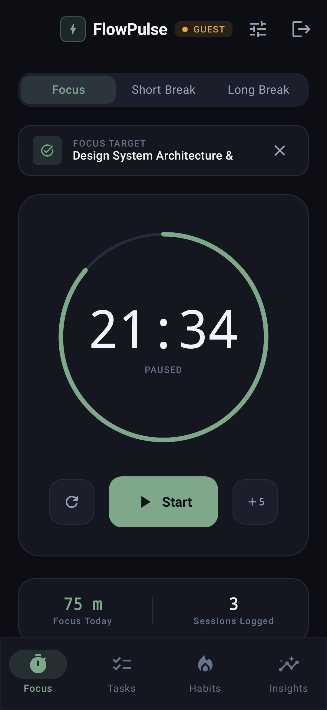
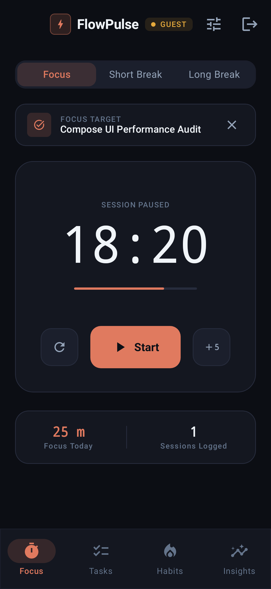
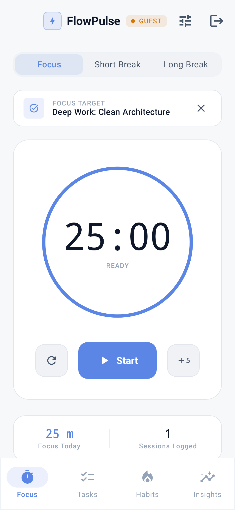
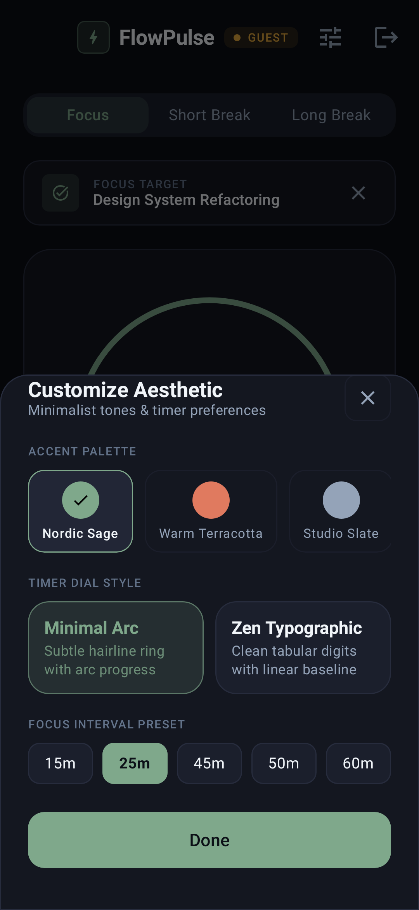
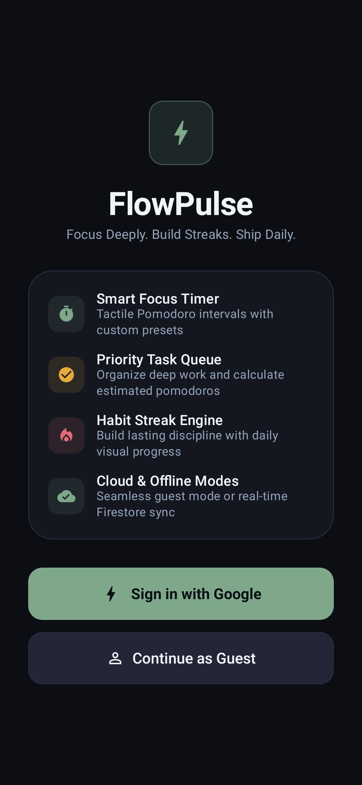
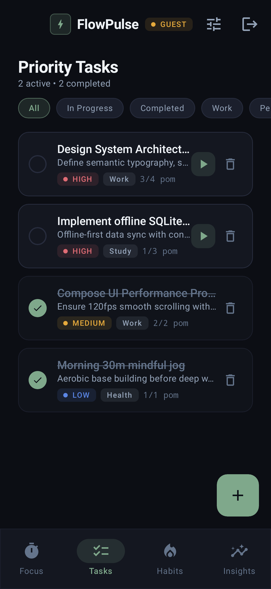
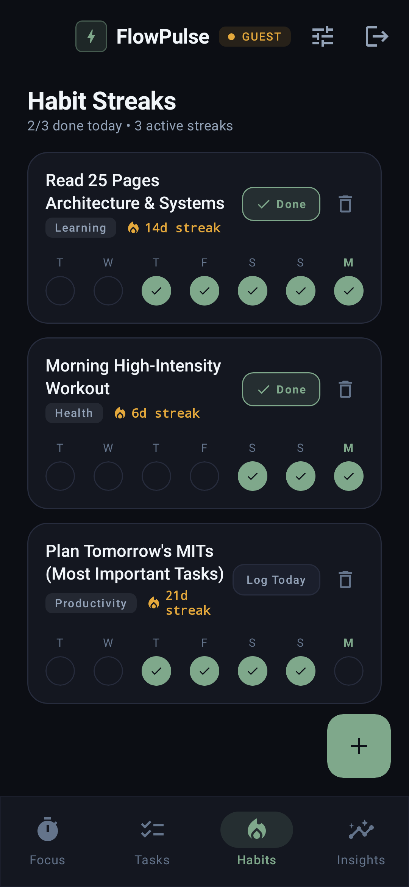
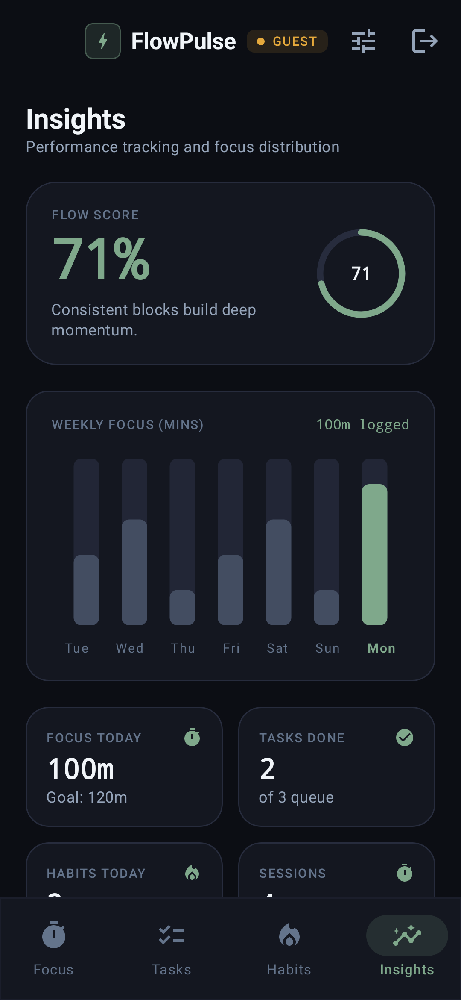

# FlowPulse ⚡

<p align="center">
  <strong>Minimalist Deep-Work Companion & Habit Engine for Android</strong><br>
  Built with Jetpack Compose, Kotlin Coroutines, and the Custom <em>FlowTheme</em> Design System.
</p>

<p align="center">
  
  
  
  
  
  
</p>

---

## 🌟 Overview

**FlowPulse** is a personal productivity system designed for makers, engineers, and creators who value distraction-free deep work. Instead of loud neon gradients and cluttered dashboards, FlowPulse embraces an **editorial, tactile, and highly customizable minimalist aesthetic**.

Whether you want to work completely offline in **Guest Mode** or sync metrics in real-time via **Firebase Cloud Firestore**, FlowPulse keeps your focus sessions, priority tasks, and habit streaks unified in a single seamless flow.

---

## 📸 App Screenshots

### 1. Smart Focus Timer (Customizable Styles)

FlowPulse provides multiple timer interfaces tailored to how you like to focus: from a delicate hairline progress arc to pure zen tabular typography.

| Minimal Arc (`Nordic Sage`) | Zen Typographic (`Warm Terracotta`) | Light Paper Mode (`Quiet Cobalt`) |
|:---:|:---:|:---:|
|  |  |  |
| *Hairline ring, active task link, and daily stats* | *Tabular monospace digits with baseline progress* | *Crisp high-contrast daylight paper theme* |

---

### 2. Live Customization & Theme System

Tap the **Tune** icon anytime to adjust your sensory experience without restarting the app.

| Aesthetic Customization Sheet | Authentication & Guest Mode |
|:---:|:---:|
|  |  |
| *Switch accent palettes, dial styles, and interval presets* | *Sign in with Google or continue completely offline* |

---

### 3. Execution & Insights

| Priority Tasks Queue | Habit Streak Engine | Flow Score & Insights |
|:---:|:---:|:---:|
|  |  |  |
| *Category chips, priority badges, and 1-tap focus linking* | *7-day visual consistency matrix and streak counters* | *Daily Flow Score gauge, 7-day focus chart, and 2x2 KPI grid* |

---

## 🎨 FlowTheme Design System

FlowPulse features a standalone, bespoke design system ([`FlowDesignTokens.kt`](app/src/main/java/com/example/ui/designsystem/FlowDesignTokens.kt) & [`FlowComponents.kt`](app/src/main/java/com/example/ui/designsystem/FlowComponents.kt)):

### Curated Accent Palettes
* **Nordic Sage** (`#7FA88B`): Calm, organic, and grounded focus.
* **Warm Terracotta** (`#E07A5F`): Earthy warmth with an industrial feel.
* **Studio Slate** (`#E2E8F0`): Clean, distraction-free monochrome.
* **Quiet Cobalt** (`#5B86E5`): Deep Nordic clarity and structure.
* **Dusk Lavender** (`#9D84B7`): Soft, contemplative twilight tone.
* **Solar Amber** (`#E5A93C`): Warm honey tone without neon glare.

### Semantic Design Tokens
- **Background & Surfaces:** Matte obsidian (`#0C0E14`), charcoal surface (`#141720`), elevated card surfaces (`#1B1F2C`), and hairline borders (`#272C3D`).
- **Typography:** Tabular monospace digits for timers, high-legibility display headers, and refined small metadata labels.
- **Custom UI Components:**
  - `FlowCard`: Hairline border surface card with smooth clipping.
  - `FlowButton`: Tactile buttons supporting `Primary`, `Secondary`, `Outlined`, and `Danger`.
  - `FlowSegmentedControl`: Animated pill mode switcher.
  - `FlowChip`: Minimalist category and status filters.
  - `FlowBadge`: Category and priority pills with colored indicator dots.
  - `FlowMetricTile`: KPI metric cards with uppercase labels and monospace numerals.

---

## 🚀 Key Features

* **⏱️ Tactile Focus Timer:**
  - Switch between `Focus` (25m), `Short Break` (5m), and `Long Break` (15m).
  - Quick-adjust interval presets (15m, 25m, 45m, 50m, 60m).
  - 1-tap `+5m` quick bump during active sessions.
  - Link any active task directly to the timer dial.

* **📋 Priority Task Queue:**
  - Categorize by `Work`, `Personal`, `Study`, `Health`, or `Creative`.
  - Filter tasks dynamically by status or priority (`High`, `Medium`, `Low`).
  - Track estimated vs. completed pomodoros (`🍅 3/4`).
  - 1-tap play button to immediately start focusing on a selected task.

* **🔥 Habit Streak Engine:**
  - Track recurring routines with customizable weekly targets.
  - Interactive **7-day visual dot matrix** highlighting daily completion.
  - Current streak and best streak record tracking.

* **📊 Deep Insights & Flow Score:**
  - **Daily Flow Score (0-100%)**: Weighted calculation combining task completions (35%), habit consistency (35%), and daily focus goal minutes (30%).
  - **7-day Weekly Focus Bar Chart**: Slender rounded canvas bars highlighting daily focus distribution with today's accent indicator.
  - **Category Breakdown**: Horizontal progress bars showing time invested across life domains.

* **🛡️ Dual-Mode Architecture (Offline Guest Mode + Firebase Sync):**
  - **Guest Mode:** Instant offline productivity powered by `GuestProductivityRepository` with in-memory persistence—no sign-in required.
  - **Google Sign-In + Cloud Firestore:** One-tap sign-in using Android Credential Manager and Google Identity services, with real-time Firestore synchronization.

---

## 🛠️ Architecture & Tech Stack

```
com.example
├── data
│   ├── model            # Immutable data models (Task, Habit, FocusSession, UserProfile)
│   ├── repository       # ProductivityDataSource abstraction
│   │   ├── ProductivityRepository.kt       # Firestore real-time implementation
│   │   └── GuestProductivityRepository.kt  # Offline guest implementation
│   └── util             # Firestore error mappings
├── ui
│   ├── auth             # AuthScreen & Google Credential Manager integration
│   ├── components       # PomodoroTimer & PomodoroTimerDisplay
│   ├── designsystem     # FlowTheme, FlowColors, FlowShapes, FlowComponents
│   ├── screens          # TimerScreen, TasksScreen, HabitsScreen, AnalyticsScreen
│   ├── theme            # MaterialTheme bridge & Color definitions
│   └── viewmodel        # ProductivityViewModel & Factory
└── MainActivity.kt      # Main navigation and top/bottom bar scaffolding
```

- **Framework:** Jetpack Compose (BOM `2024.09.00`)
- **Language:** Kotlin 2.2.10
- **Asynchronous Flow:** Kotlin Coroutines & `StateFlow` with `collectAsStateWithLifecycle`
- **Backend & Auth:** Firebase Authentication, Cloud Firestore, Android Credential Manager
- **Testing & Verification:** Robolectric 4.16.1 Native Graphics, JUnit 4, Compose UI Test

---

## 💻 Getting Started

### Prerequisites
- Android Studio Ladybug / Meerkat or later
- JDK 17 or later
- Android SDK 35 / 36

### Building from Source

```bash
# Clone the repository
git clone https://github.com/your-username/flow-sync.git
cd flow-sync

# Build Debug APK
./gradlew :app:assembleDebug

# Run Unit and UI Tests
./gradlew :app:testDebugUnitTest
```

### Reproducing App Screenshots

The screenshots in this README are captured directly from actual Jetpack Compose rendered hierarchies using Robolectric native graphics:

```bash
./gradlew :app:testDebugUnitTest --tests com.example.ui.ScreenshotGeneratorTest
```

Outputs are automatically saved to [`docs/screenshots/`](docs/screenshots/).

---

## 📄 License

This project is licensed under the Apache 2.0 License.
